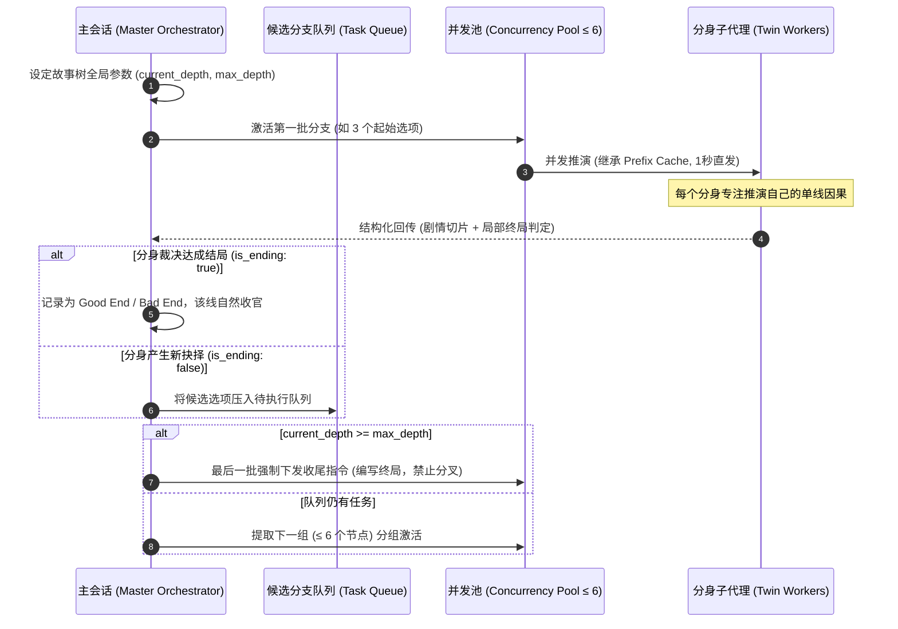

# 🌌 Antigravity Twin Agents (同文孪生分身)

> **专为 Google Antigravity (AGY) 与 Gemini 3.8 打造的零交接损耗同文分身框架与工业级巨型故事树生成引擎**

[](LICENSE)
[](#)
[](#)

---

## 💡 为什么做这个项目？

### 1. 寻找 Gemini 3.8 的能力变现杀手级场景
Gemini 3.8 / 1.5 系列模型拥有当前 AI 领域的顶级天赋：**百万级超长上下文**、**极高的生成吞吐（High TPS）**、**极低成本的前缀缓存（Prefix Caching）** 以及卓越的文学因果推理能力。

然而，在日常开发中，这些天赋往往只被用来回答单次对话或补全小段代码，其澎湃的并发与长文本算力缺乏具有商业化想象力的落地场景。

### 2. 游戏工业的永恒之痛：指数级故事树（Combinatorial Explosion）
在文字冒险游戏（AVG）、互动小说（CYOA）、开放世界 RPG 和跑团游戏（TRPG）中，玩家渴望真正的自由抉择：
$$1 \to 3 \to 9 \to 27 \to 81 \dots$$
然而，对于人类策划与编剧团队而言，每一层分支都意味着工作量的指数级激增。写到第 10 层就有近 6 万个结局，任何人类团队都会因精力和成本被迫将分支强行折叠回单主线（菱形结构）。

### 3. 解法：同文分身 + 池化节流调度
`antigravity-twin-agents` 改变了这一切：
* **显式因果链注入与物理前缀缓存**：主会话将当前支线的祖先因果链注入 Prompt 前缀，同一批次分身共享完全一致的前置历史 Token，在 Gemini 底层精准物理命中 Prefix Cache，既杜绝分身失忆断层，又享受极低边际成本；
* **单线沉浸与认知解耦**：每个分身在主观感知里**只写了一条自洽的连续单线史诗**，彻底根除单 AI 俯瞰全局带来的“人格分裂”、“提前剧透”与“敷衍收尾”；
* **Claude Code 风格的并发池节流（≤ 6 并发）**：面对数十甚至上百个候选分支，主控采用任务队列与滑动窗口分组激活，杜绝 API 限频与智能体雪崩。

---

## 🧪 实测基准与“不可思议之树”思想实验 (Benchmark & Thought Experiment)

### 🇨🇳 中文部分：从 5 层实测到 10 层神迹的算力推演

#### 1. 一手实测数据（Gemini 3.8 Pro 订阅环境）
在纯 3 分歧（$1 \to 3 \to 9 \dots$）真实测试中：
* **5 层全量故事树**：全树共 **364 个节点**（$3^5 = 243$ 个叶子结局），仅消耗单 Pro 账号 5 小时滚动配额的 **~20%**；
* **6 层全量故事树**：全树共 **1,093 个节点**（$3^6 = 729$ 个叶子结局），节点数恰好是 5 层的 3 倍，实际消耗配额为 **~60%**（一大半）。

> **💡 关键工程结论**：  
> 配额消耗完全与**新增节点数线性挂钩**，并未因历史变长而产生二次方重算爆炸！这从实测上铁证了 **Gemini 前缀缓存（Prefix Caching）** 对前置路径实现了 90%+ 的高效命中，使大规模深层分支推演在经济上切实可行。

#### 2. 思想实验：当拥有 3 个 Pro 账号时，算力边界在哪里？
已知 1 个 Pro 账号 5 小时可稳定消化 $\approx 1,820$ 个节点，**3 个 Pro 账号在 5 小时内拥有 $\approx 5,460$ 个节点的处理能力**：

| 深度 (Depth) | 最终互斥结局数 (Leaves) | 故事树全量节点 (Total Nodes) | 估算文本体量 (400字/节点) | 3 个 Pro 账号理论耗时 |
| :---: | :---: | :---: | :---: | :---: |
| **5 层** | 243 | 364 | 约 15 万字 | 1 个账号耗时 1 小时 |
| **6 层** | 729 | 1,093 | 约 44 万字 | 1 个账号耗时 3 小时 |
| **7 层** | 2,187 | **3,280** | 约 130 万字 | **3 账号仅需 1 个周期（约 3 小时）** |
| **8 层** | 6,561 | **9,841** | 约 400 万字 | **3 账号仅需约 9 ~ 10 小时（2 个周期）** |
| **10 层 (神迹)** | **59,049** | **88,573** | **约 3,540 万字** | **3 账号全开仅需约 80~85 小时（< 4 天！）** |

#### 3. 思想震撼：10 层故事树的人文与工业奇观
* **3,540 万字是什么概念？** 相当于 **35 本《红楼梦》** 或 **30 部全套《哈利·波特》** 的字数总和；
* **本质飞跃**：这 3,500 万字不是单线灌水，而是**在 59,049 条互斥平行宇宙中、以严苛的因果自洽性立体铺开的纯无环巨型故事树**；
* **结论**：没有任何人类作家团队能在整个人生中肉身完成这样一部作品；但借助反重力分身架构与 Gemini 3.8，**3 个普通 Pro 账号在不到 4 天内就能将其算力落地为现实资产**。

---

### 🇺🇸 English: Benchmark & The "Impossible Tree" Scaling Hypothesis

#### 1. Empirical Ground Truth (Gemini 3.8 Pro Tier)
Benchmarked on pure 3-choice branching ($1 \to 3 \to 9 \dots$):
* **Layer 5 Full Tree**: **364 total nodes** ($3^5 = 243$ leaf endings) consumes **~20%** of a single Pro account's 5-hour rolling quota.
* **Layer 6 Full Tree**: **1,093 total nodes** ($3^6 = 729$ leaf endings, exactly $3\times$ Layer 5) consumes **~60%** of the 5-hour quota.

> **Key Finding**: Quota usage scales **strictly linearly with incremental node count**. Thanks to **Gemini's Prefix Caching**, ancestor context across 5 steps is reused at near-zero marginal cost, preventing quadratic re-computation collapse.

#### 2. The Thought Experiment: Scaling with 3 Pro Accounts
With 1 account delivering $\approx 1,820$ nodes per 5h window, **3 Pro accounts provide a throughput of $\approx 5,460$ nodes / 5 hours**:

* **Layer 7**: 3,280 nodes, 2,187 distinct endings (~1.3M words) $\to$ **Completed in a single 5h window (~3h actual runtime)**.
* **Layer 8**: 9,841 nodes, 6,561 distinct endings (~4.0M words) $\to$ **Completed in ~9 to 10 hours** (2 reset cycles).
* **Layer 10 (Mythical Tier)**: **88,573 nodes**, **59,049 mutually exclusive endings**, totaling **~35.4 Million words** $\to$ **Completed in under 4 days (< 85 hours) by 3 Pro accounts running 24/7!**

#### 3. The Paradigm Shift
35.4 million words of acyclic, causal branching narrative equals 35 copies of *Dream of the Red Chamber* or 30 complete sets of *Harry Potter*. While physically impossible for human writers in a lifetime, this framework transforms Gemini 3.8's high concurrency and prompt cache into tangible game-industry assets within 90 hours.


## 🏛️ 核心架构与调度模型



### 职责严格切分

| 角色 | 权限与职责边界 |
| :--- | :--- |
| **主会话 (Master Orchestrator)** | **全局独占权**：独占全局拓扑图、最大深度（`max_depth`）与节点激活权；维护队列，按滑动窗口（$\le 6$ 个并发）分组激活。 |
| **分身子代理 (Twin Worker)** | **单线沉浸 + 局部终结自决**：无权擅自裂变；沉浸于自身分支的连续推演；自主裁决本步是 `is_ending: true`（GE/BE/NE）还是生成候选选择肢。 |

---

## 🌟 核心应用场景

### 场景 A：巨型文字冒险游戏故事树生成
```text
用户：“以当前剧情点展开分支故事树，按批次并发池（≤6个分身）推进，控制最大深度为 3 层并自动终局收束。”
```
1. 主会话将根节点分支推入队列；
2. 调度池以 3~6 个并发分身推进；
3. 每个分身写完片段后自决结局状态；
4. 最终主会话自动聚合输出完整的 Mermaid 故事树与分步剧情文件。

### 场景 B：认知现场零交接复盘 $(G, C, S, M) \to (G, C, S', M')$
```text
用户：“派发分身子代理，异步复盘刚才的修改有没有逻辑漏洞与未尽事项。”
```
* **继承保留 $(G, C)$**：保留用户根本意图 $G$ 与客观现状代码 $C$；
* **重推解耦 $(S', M')$**：摆脱主对话的局部策略惯性 $S$ 与表面指标 $M$，从第一性原理做开放复盘与扫尾自修。

---

## 📁 目录结构

```text
antigravity-twin-agents/
├── plugin.json                         # Antigravity 插件配置清单 (v0.2.0)
├── README.md                           # 插件使用、双模架构与理论推导说明
├── LICENSE                             # MIT 开源协议
├── agents/
│   └── twin.md                         # "twin" 认知与叙事分身系统提示词（已移除递归权限）
├── skills/
│   └── twin-agents/
│       └── SKILL.md                    # 主会话调度协议：认知复盘/叙事推演双模调用范式
├── rules/
│   └── AGENTS.md                       # 常驻规则：显式现场注入、缓存亲和度、防写竞争与池化节流
├── scripts/
│   └── story_tree_scheduler.py         # 故事树池化调度器（并发<=6，祖先亲和度排序，Mermaid导出）
├── tests/
│   └── test_narrative_twin.py          # 自动化单元测试套件（并发上限、截断与排序断言）
└── examples/
    └── live_experiment_transcript.md   # 真实实机推演实验日志（Antigravity 实测原始报文）
```

---

## 🛠️ 可执行调度器与测试验证 (Executable & Tests)

为保证项目 100% 可独立运行与复现，仓库内置了生产级调度器与完整测试套件：

### 1. 运行自动化单元测试
```powershell
python -m unittest discover tests
```
* 断言并发运行池永远严格 $\le 6$；
* 验证祖先亲和度排序算法（相同父节点的任务紧密相邻，以越过 4k tokens 缓存门槛）；
* 验证全局最大深度截断与终局收敛。

### 2. 运行故事树并发池调度器原型
```powershell
python scripts/story_tree_scheduler.py --demo --depth 2 --concurrency 6
```
将自动输出基于祖先亲和度分组的滑动批次调度轨迹，并导出完整 Mermaid 故事拓扑图。

### 3. 查看真实实机推演凭证
详细查阅 [`examples/live_experiment_transcript.md`](examples/live_experiment_transcript.md)，获取在 Antigravity 真实环境下执行由分身 `5d83bf54-fdf8-4022-8f6d-32f3d5b5f1e6` 推演并回传的完整原始报文。

---

## 🚀 安装与使用


### 1. 安装到 Google Antigravity
克隆或复制本仓库到你的 Antigravity 插件配置目录：

```powershell
# Windows
git clone https://github.com/zjj1280637679-ship-it/antigravity-twin-agents.git "$HOME\.gemini\config\plugins\twin-agents"
```

### 2. 常用 Prompt 指令

* **生成游戏分支树**：
  > “以当前主角的选择为起点，派发分身推演后续分支。最大层数限制为 3 层，每次激活最多 6 个分身，并在各分支终点自主评估结局。”
* **代码异步复盘**：
  > “派发一个分身子代理，异步复盘刚刚交付的代码，重点检查边界条件与异常处理，低风险问题直接修复，重大发现写信汇报。”

---

## 📄 结构化通信契约 (Runtime Contract)

分身通过 `send_message` 与主会话通信，严格遵循极简 YAML 规范：

```yaml
severity: info | warning | critical
kind: branch_step | cleanup | verification | premise | regression
finding: <核心事实、剧情节点摘要或推演结果>
evidence: <关键上下文片段或测试文件>
is_ending: true | false                 # 本步是否已到达终局（若为 true 则该分支自然收官）
ending_type: good_end | bad_end | normal_end | none
next_branches:                          # 若未结局，列出候选分歧供主会话队列调度
  - choice_id: "A"
    summary: "选项描述与行动意图"
  - choice_id: "B"
    summary: "选项描述与行动意图"
action_taken: <就地完成的修复或产出的章节文本/文件>
recommended_next: <建议主会话后续调度关注的事项>
```

---

## 🤝 关联项目
* [codex-twin-agents](https://github.com/zjj1280637679-ship-it/codex-twin-agents): 基于 OpenAI Codex 与 Responses multi-agent 的同文孪生前序探索。

---

## 📜 开源协议
本项目采用 [MIT License](LICENSE) 开源协议。
